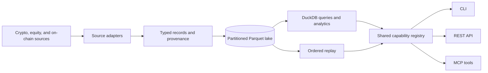

# Crocodile

Crocodile is a Python market-data engine for collecting, normalizing, storing, and replaying crypto and equity data, including listings outside the US keyed by ISO 10383 MIC. It writes a local Parquet lake, exposes it through DuckDB, and provides CLI, REST, and MCP interfaces over a shared capability registry.

Use it to build a research dataset, inspect order books and trades, calculate market analytics, or replay observations you have recorded. Crocodile is a headless data layer; it has no trading interface or order-execution service.

## What it provides

- **Market connectors:** native crypto adapters, a universal CCXT adapter, equity providers, a universal equity layer keyed by ISO 10383 MIC, SEC filings, macro series, and selected on-chain sources. Available channels depend on each source.
- **Market reference data:** 172 exchanges in 129 countries and territories, with ISO 10383 MICs, ISO 4217 currencies, trading calendars, canonical `SYMBOL@MIC` listing symbols, and sanctioned markets closed by default ([coverage](docs/global-markets.md)). Collection for listings outside the US is described under [Global equities](#global-equities).
- **A shared schema:** typed records for trades, books, quotes, bars, derivatives, filings, and related observations, with source identity and timestamps.
- **Local storage and queries:** partitioned Parquet, channel discovery, DuckDB SQL, exports, and OHLCV resampling.
- **Replay:** a globally ordered stream from stored records, plus a separate raw-capture path for supported native feeds.
- **Analytics:** funding and basis, volatility surfaces, order-flow imbalance, slippage, open interest, and selected on-chain measures.
- **Three access surfaces:** shell commands, a FastAPI service, and an MCP stdio server generated from the same capability definitions.

## How it compares


CCXT and yfinance are source-access libraries. Crocodile uses connectors, including these libraries, as inputs to a common storage and analysis pipeline. The comparison describes their default responsibilities; it does not rank data quality or benchmark one library against another. See the [comparison sources and methodology](docs/media/COMPARISONS.md).

Local storage does not grant additional data rights. Source terms, quotas, authentication, historical coverage, and redistribution rules still apply. Crocodile does not supply a licensed historical archive or a service-level agreement.

## Start locally

Requires Python 3.12+, Git, and [uv](https://docs.astral.sh/uv/). Install from this repository: the PyPI name `crocodile` belongs to an unrelated project.

```bash
git clone https://github.com/nazmiefearmutcu/Crocodile.git
cd Crocodile
uv sync
uv run crocodile --help
```

Collect one minute of public Deribit trades, query the lake, then replay it:

```bash
uv run crocodile collect --asset-class crypto --sources deribit --symbols BTC-PERPETUAL --channels trade --duration-seconds 60 --data-dir data

uv run crocodile query --asset-class crypto --data-dir data "SELECT count(*) AS trades FROM trade"

# Read the recorded time window (nanoseconds).
uv run crocodile query --asset-class crypto --data-dir data "SELECT min(local_ts) AS start_ns, max(local_ts) + 1 AS end_ns FROM trade"

# Replace START_NS and END_NS with the values returned above.
uv run crocodile replay --asset-class crypto --channels trade --symbols deribit:BTC-PERPETUAL --start-ns START_NS --end-ns END_NS --data-dir data
```

Collection uses the venue symbol; replay and analytics use the canonical symbol stored in the lake, such as `deribit:BTC-PERPETUAL`. Use the bounded timestamps returned by the query rather than an all-time interval. Collection requires access to the selected source. Query and replay read the specified lake; a fresh clone contains no sample market data. DuckDB views follow the channels present on disk, such as `trade` or `ohlcv`; there is no universal `records` table. Use `crocodile catalog-channels --help` to inspect the catalog interface.

| Optional extra | Adds |
|---|---|
| `market` | Universal CCXT venue access. |
| `web` | FastAPI, Uvicorn, Streamlit, and on-chain dependencies. |
| `ml` | XGBoost, SciPy, and headless Matplotlib analytics. |
| `onchain` | Web3-based connectors. |
| `full` | All four extras above. |

For example, `uv sync --extra market` installs the universal connector dependencies. When using `uv run`, request the same extra for commands that need it. Native connectors and the local lake are in the base installation.

## Architecture



| Location | Responsibility |
|---|---|
| [`core/`](src/crocodile/core/) | Record types, provenance, market reference data (MICs, currencies, calendars, listing master), ingest coordination, storage, resampling, and replay. |
| [`crypto/`](src/crocodile/crypto/) | Native and CCXT adapters, instruments, and crypto analytics. |
| [`equity/`](src/crocodile/equity/) | Equity providers, the universal source layer, reference data, and analytics. |
| [`capabilities/`](src/crocodile/capabilities/) | Parameters, implementations, and asset-class support for each capability. |
| [`surfaces/`](src/crocodile/surfaces/) | CLI, REST, and MCP projections of those definitions. |

Records distinguish `native`, `derived`, and `synthetic` observations. An unavailable capability reports that state without fabricating records. Provenance includes the method, its inputs, and a registered confidence formula. Confidence measures sampling adequacy within a provenance class; it is not a probability that a synthetic value is true.

## Sources and configuration

Native crypto adapters include Binance, Bybit, Coinbase, Deribit, and OKX; other adapters cover selected DEX and on-chain sources. The optional CCXT path broadens venue access, with REST polling and WebSocket support where implemented. Venue counts depend on the installed CCXT version and do not imply identical channel coverage.

Equity adapters include Alpaca, Yahoo, SEC EDGAR, FINRA, Treasury, Tiingo, Stooq, MSN Money, Google Finance, and Finnhub, plus the universal sources described under [Global equities](#global-equities). Credentials and channel coverage differ by provider. Settings use the `CROCODILE_` environment prefix; [`core/config.py`](src/crocodile/core/config.py) defines defaults and credential names. Set `CROCODILE_DATA_DIR` to choose the lake that `collect` and `backfill` fill; `--data-dir` selects the lake a data read queries, and the lake `universe-sync` and `schedule` fill, as [Global equities](#global-equities) explains. `CROCODILE_ALLOW_SANCTIONED_MARKETS` (comma-separated ISO country codes from RU, BY, IR, SY, KP) opens markets that are closed by default.

## Global equities

Crocodile also collects equities listed outside the US. A market reference layer (`crocodile.core.markets`) keys every listing by its ISO 10383 operating MIC, and a universal source layer (`crocodile.equity.universal`) fills those listings from public sources. A non-US listing's canonical symbol is `{local}@{MIC}`, such as `THYAO@XIST`, `7203@XJPX` or `VOD@XLON`. US tickers stay bare (`AAPL`), so existing US partitions keep their buckets. When `--asset-class` is omitted, the surfaces read a symbol ending in a registered `@MIC` as equities.

### What is covered

`src/crocodile/core/markets/data/exchanges.csv` lists 172 exchanges in 129 countries. Each row gives the time zone, trading currency, usual quote scale, weekend and research tier. A closing time is given for 69 of the 172 rows (68 from the library calendar and one from a primary source); the other 103 are marked `close_local:unknown` in their notes. The table is an allow-list: a listing whose exchange is not in it is skipped and counted under `unknown_exchange_code`, and adding an exchange is a data change.

68 of them have a library calendar from `exchange_calendars`. The other 104 use a weekday fallback. Their weekend is Saturday and Sunday unless the table says otherwise, and where that weekend is unverified the notes column says so. The fallback knows no holidays, so a day without data there is recorded as `no_data`, not as a gap.

The ISO 10383 snapshot and the ISO 4217 list are stored unmodified in `src/crocodile/core/markets/data/`, beside `MANIFEST.json`, which records each file's source, retrieval date and SHA-256.

Listings live in a local listing master, `<data_dir>/reference/listings.sqlite`. It holds issuers, instruments (keyed by ISIN) and listings (MIC, local symbol, currency, price scale and status). It keeps every source's spelling as an alias with a validity window, and it records changes to currency, status and aliases as events. A listing is unique on its MIC and local symbol, so `000001@XSHE` and `000001@XSHG` are two listings. Instrument types are `SecurityType` members, such as `CS`, `ETF`, `GDR` and `BOND`.

### Sources and usage classes

| Source | Gives | Usage class |
|---|---|---|
| `yahoo_chart` | Daily history, dividends and splits; intraday bars within Yahoo's windows for listings you select | `internal` |
| `tradingview` | The listed universe per market and an end-of-day snapshot; no history | `internal` |
| `nasdaqtrader` | US listings from the NASDAQ Trader symbol directories | `internal` |
| `nse_india` | NSE India listings | `internal` |
| `asx` | ASX-listed companies | `internal` |
| `twse` | TWSE listings, under the Open Government Data License v1.0 (attribution required) | `redistribution` |

A usage class states what a source's terms let you do with its data. A value derived from several sources takes the most restrictive class among them, as `crocodile.core.markets.usage.most_restrictive` computes it.

- `redistribution`: the terms allow passing the data on, possibly with attribution.
- `display`: the data may be shown to a deployment's end users but not passed on as data.
- `internal`: internal analysis only, never served outward.

Sources whose terms are unclear or restrictive, called grey sources, are **on by default**. This is the maintainer's decision. Yahoo's terms, as the research reviewed them, prohibit automated access, and TradingView's terms have not been reviewed. Three rules hold regardless:

- Every record keeps its real source name. `universal` is an alias for a market's declared source order and never appears on a record.
- Access controls (CAPTCHAs, bot pages, proof-of-work, geographic blocks) are never bypassed. A source that meets one reports itself as unservable and gives the reason.
- `crocodile.contrib.evasion` stays opt-in, and these sources do not use it.

Storing data locally grants no redistribution rights. There is no switch that turns grey sources off in this release.

When several sources hold the same day, reads choose by MIC and channel from `src/crocodile/equity/universal/data/source_order.csv`. For a US listing the native sources come first. For other markets, prices list `yahoo_chart` before `tradingview`, and instruments list the official directory where one exists (Nasdaq Trader, ASX, NSE India, TWSE), then `tradingview`.

### Run it

The first three commands contact the sources. The last three read local data.

```bash
# Put Turkey's listings in the listing master (TradingView universe, plus an official
# directory where a market has one).
uv run crocodile universe-sync --country TR --data-dir data

# Full daily history for those listings; a rerun resumes per listing. --start-ns 0 means all
# history; --end-ns is the last day, as epoch nanoseconds at UTC midnight (here 2026-11-08).
uv run crocodile backfill --asset-class equity --sources universal --country TR --channel ohlcv --start-ns 0 --end-ns 1794096000000000000 --data-dir data

# One scheduler tick: the latest completed session of each due market.
uv run crocodile schedule --asset-class equity --country TR --once --data-dir data

# Coverage report, calendar and the data itself.
uv run crocodile markets --asset-class equity --country TR --data-dir data
uv run crocodile calendar --asset-class equity --mic XIST --start 2026-01-01 --end 2026-01-31
uv run crocodile query --asset-class equity --data-dir data "SELECT symbol, source_ts, close, currency, price_scale FROM ohlcv WHERE symbol = 'THYAO@XIST' ORDER BY source_ts DESC LIMIT 5"
```

`universe-sync` and `schedule` are operator commands, like `migrate-lake`. They change local state or run for a long time, so REST and MCP do not expose them.

`collect` and `backfill` always write under `CROCODILE_DATA_DIR` (default `data`), even when `--data-dir` is given. `universe-sync` and `schedule` write under `--data-dir` when it is given, and under `CROCODILE_DATA_DIR` when it is not; the listing master, the sink and the scheduler state all follow that choice. `universe` and `markets` read the listing master from `--data-dir` when it is given, and from `CROCODILE_DATA_DIR` otherwise; `markets` reads its coverage state from the same place. `--data-dir` also changes which lake the other data reads (`query`, `replay` and the other Catalog reads) look in. To keep one lake, set `CROCODILE_DATA_DIR` to that lake and leave `--data-dir` out: `collect` and `backfill` write there whatever `--data-dir` says, and a `--data-dir` on `universe-sync` or `schedule` moves those writes elsewhere. The examples use `data`, the default, so they agree either way.

`collect`, `backfill`, `markets` and `universe` take `--mic` or `--country`. Backfill resumes each listing from its watermark. Yahoo answers one listing per request, so a whole-country backfill takes a while at the shared rate budget. Daily collection uses one TradingView snapshot per market instead. `schedule` collects a market 45 minutes after its calendar close. A date that fails three times is recorded as a gap, and the watermark moves on.

`markets --asset-class equity` is a coverage report with one row per exchange. The crypto half returns the same columns, empty where it observes nothing. On equity rows `venue` repeats the MIC.

Columns: `venue`, `native`, `ccxt`, `mic`, `name`, `country`, `timezone`, `currency`, `quote_scale`, `calendar_quality`, `sources`, `usage_classes`, `tier_research`, `sanctioned`, `listings_known`, `last_success`.

`sources` is ordered by the source order above, `usage_classes` is aligned with it, and `last_success` is epoch nanoseconds, or null when no universal run has succeeded. `tier_research` is the access tier the 2026-11-08 research assigned:

- A: official, free and keyless.
- B: a keyless aggregator answered.
- C: a free key is documented.
- D: no free route was verified.

It measures access friction, not legal fitness.

### Prices, currencies and `price_scale`

Prices are stored in the unit the source publishes. `price_scale` says how many decimal places that unit sits below the currency's major unit, so the major-unit price is `value / 10 ** price_scale`. A London listing quoted in pence (`GBX`) is written with `currency = 'GBP'` and `price_scale = 2`. South African cents (`ZAc`) and Israeli agorot (`ILA`) work the same way. A query that ignores `price_scale` reads those listings 100 times too high. `markets` shows each exchange's usual `quote_scale`, and `crocodile.core.markets.currency.to_major` converts exactly with `Decimal`. `NULL` in `currency` or `price_scale` means unknown, either because the row was written before these columns existed or because the source did not say. It is never USD. A record whose currency disagrees with its listing's is not written to the lake; it goes to the dead-letter queue. This release has no converted view in major units or in another currency.

### Sanctioned markets

Sanctioned by default: `RU`, `BY`, `IR`, `SY`, `KP`.

Exchanges in those countries are off by default, and a request for one raises `SanctionedMarketError`. `CROCODILE_ALLOW_SANCTIONED_MARKETS=RU,BY` turns the named countries back on. A row can carry a sanctions note without being closed by default: Libya's exchange row (`XLSM`) notes `sanctions:targeted` and is not closed. The list is data (`src/crocodile/core/markets/data/sanctions.csv`), not legal advice.

### What is measured and what is not

`markets` reports what is declared: exchange rows, grammars, source order and calendar quality. Whether a source actually answers for a market is a separate question, and only a measurement answers it. `scripts/measure_global_equity.py` runs universe-sync, a small backfill sample, one end-of-day pass and `markets` for twelve countries. It makes at most three requests per endpoint, about one per second per host, and it stops at 250 requests by default. It writes HTTP statuses, timings, counts and failures as JSON and Markdown. A measurement describes one day. Quotas, long-run availability, data accuracy against an official record, publication latency, and whether a source's terms permit your use are not measured. Calendars are cross-checked offline against the in-house US calendar (2024–2027) and Borsa Istanbul's published 2026 holidays.

## Analytics

The Python API reads the same local catalog as the command surfaces:

```python
from crocodile.core.store.catalog import Catalog
from crocodile.crypto.analytics.funding import funding_apr
from crocodile.crypto.analytics.volsurface import iv_surface

catalog = Catalog(data_dir="data")
# Supply timestamps in nanoseconds and collect the relevant channels first.
# funding_apr(catalog, "binance:BTCUSDT", start_ns, end_ns)
# iv_surface(catalog, "BTC", at_ns, rate=0.0)
```

See [`examples/`](examples/) for runnable analyses. Options calculations need options observations; an empty lake cannot supply them.

## REST and MCP

```bash
uv run --extra web crocodile api --data-dir data
uv run crocodile mcp --data-dir data
```

The REST service defaults to `127.0.0.1:8000`, with routes under `/api/v1/`. MCP communicates through stdin/stdout for compatible clients. The shared registry defines schemas and asset-class support; individual capabilities may return derived, synthetic, or unavailable results depending on the data and requested market.

## Raw capture and replay

Set `CROCODILE_RAW_CAPTURE=true` to journal supported Binance or Deribit native frames alongside normalized collection. The raw journal retains feed payloads, snapshot anchors, and book decisions, with bounded queues and integrity checks. This is separate from replaying normalized Parquet records.

See the [raw-capture guide](docs/raw-capture.md) for the replay API, failure behavior, Binance SBE and authorized Deribit raw configuration. Higher-frequency feeds require their documented credentials; raw replay itself needs none. Capture cannot reconstruct updates missed before recording began.

## Measured storage comparison


The chart uses the repository's network-free benchmark with 500,000 synthetic trades and a fixed seed. It compares serialized size, including Parquet's Zstandard compression; it does not measure exchange latency, live ingestion capacity, or competing services. The [full run and machine details](docs/media/benchmark-run.md) include normalization, writing, queries, resampling, and replay. Reproduce with `uv run python -X utf8 benchmarks/bench.py`.

## Development and license

```bash
uv sync --all-extras
uv run --all-extras pytest tests/
```

Tests cover adapters, schemas, provenance, query boundaries, sequence handling, raw capture, and replay, including cross-process byte-identity checks. Static-analysis coverage and legacy exceptions are defined in [`pyproject.toml`](pyproject.toml); see [CHANGELOG.md](CHANGELOG.md) for changes and [release notes](docs/release-notes-0.4.0.md) for the current data model. [Global market coverage](docs/global-markets.md) lists the 172 exchanges in 129 countries and territories that the market reference layer knows.

[Apache License 2.0](LICENSE).

Created By Aylin (Nazmi Efe Armutcu)
