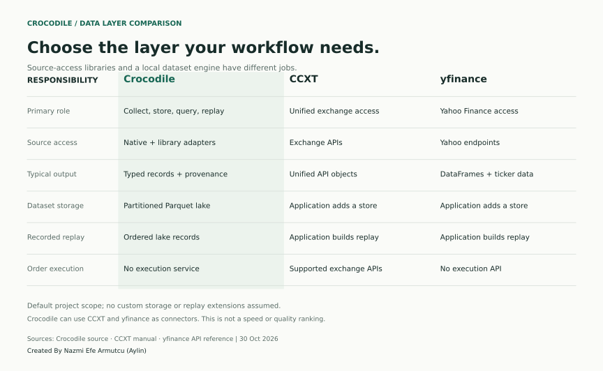
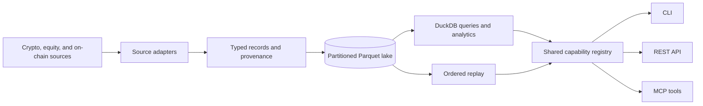
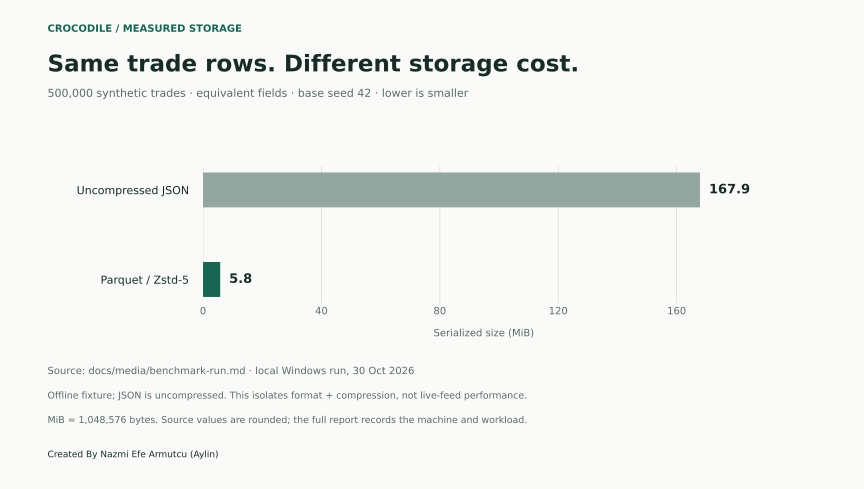

# Crocodile

Crocodile is a Python market-data engine for collecting, normalizing, storing, and replaying crypto and US equity data. It writes a local Parquet lake, exposes it through DuckDB, and provides CLI, REST, and MCP interfaces over a shared capability registry.

Use it to build a research dataset, inspect order books and trades, calculate market analytics, or replay observations you have recorded. Crocodile is a headless data layer; it has no trading interface or order-execution service.

## What it provides

- **Market connectors:** native crypto adapters, a universal CCXT adapter, equity providers, SEC filings, macro series, and selected on-chain sources. Available channels depend on each source.
- **A shared schema:** typed records for trades, books, quotes, bars, derivatives, filings, and related observations, with source identity and timestamps.
- **Local storage and queries:** partitioned Parquet, channel discovery, DuckDB SQL, exports, and OHLCV resampling.
- **Replay:** a globally ordered stream from stored records, plus a separate raw-capture path for supported native feeds.
- **Analytics:** funding and basis, volatility surfaces, order-flow imbalance, slippage, open interest, and selected on-chain measures.
- **Three access surfaces:** shell commands, a FastAPI service, and an MCP stdio server generated from the same capability definitions.

## How it compares



CCXT and yfinance are source-access libraries. Crocodile uses connectors, including these libraries, as inputs to a common storage and analysis pipeline. The comparison describes their default responsibilities; it does not rank data quality or benchmark one library against another. See the [comparison sources and methodology](docs/media/COMPARISONS.md).

Local storage does not grant additional data rights. Source terms, quotas, authentication, historical coverage, and redistribution rules still apply. Crocodile does not supply a licensed historical archive or a service-level agreement.

## Start locally

Requires Python 3.12+, Git, and [uv](https://docs.astral.sh/uv/). Install from this repository: the PyPI name `crocodile` belongs to an unrelated project.

```bash
git clone https://github.com/nazmiefearmutcu/Crocodile.git
cd Crocodile
uv sync
uv run crocodile --help
```

Collect one minute of public Deribit trades, query the lake, then replay it:

```bash
uv run crocodile collect --asset-class crypto --sources deribit --symbols BTC-PERPETUAL --channels trade --duration-seconds 60 --data-dir data

uv run crocodile query --asset-class crypto --data-dir data "SELECT count(*) AS trades FROM trade"

# Read the recorded time window (nanoseconds).
uv run crocodile query --asset-class crypto --data-dir data "SELECT min(local_ts) AS start_ns, max(local_ts) + 1 AS end_ns FROM trade"

# Replace START_NS and END_NS with the values returned above.
uv run crocodile replay --asset-class crypto --channels trade --symbols deribit:BTC-PERPETUAL --start-ns START_NS --end-ns END_NS --data-dir data
```

Collection uses the venue symbol; replay and analytics use the canonical symbol stored in the lake, such as `deribit:BTC-PERPETUAL`. Use the bounded timestamps returned by the query rather than an all-time interval. Collection requires access to the selected source. Query and replay read the specified lake; a fresh clone contains no sample market data. DuckDB views follow the channels present on disk, such as `trade` or `ohlcv`; there is no universal `records` table. Use `crocodile catalog-channels --help` to inspect the catalog interface.

| Optional extra | Adds |
|---|---|
| `market` | Universal CCXT venue access. |
| `web` | FastAPI, Uvicorn, Streamlit, and on-chain dependencies. |
| `ml` | XGBoost, SciPy, and headless Matplotlib analytics. |
| `onchain` | Web3-based connectors. |
| `full` | All four extras above. |

For example, `uv sync --extra market` installs the universal connector dependencies. When using `uv run`, request the same extra for commands that need it. Native connectors and the local lake are in the base installation.

## Architecture



| Location | Responsibility |
|---|---|
| [`core/`](src/crocodile/core/) | Record types, provenance, ingest coordination, storage, resampling, and replay. |
| [`crypto/`](src/crocodile/crypto/) | Native and CCXT adapters, instruments, and crypto analytics. |
| [`equity/`](src/crocodile/equity/) | Equity providers, reference data, and analytics. |
| [`capabilities/`](src/crocodile/capabilities/) | Parameters, implementations, and asset-class support for each capability. |
| [`surfaces/`](src/crocodile/surfaces/) | CLI, REST, and MCP projections of those definitions. |

Records distinguish `native`, `derived`, and `synthetic` observations. An unavailable capability reports that state without fabricating records. Provenance includes the method, its inputs, and a registered confidence formula. Confidence measures sampling adequacy within a provenance class; it is not a probability that a synthetic value is true.

## Sources and configuration

Native crypto adapters include Binance, Bybit, Coinbase, Deribit, and OKX; other adapters cover selected DEX and on-chain sources. The optional CCXT path broadens venue access, with REST polling and WebSocket support where implemented. Venue counts depend on the installed CCXT version and do not imply identical channel coverage.

Equity adapters include Alpaca, Yahoo, SEC EDGAR, Treasury, Tiingo, Stooq, MSN Money, Google Finance, and Finnhub. Credentials and channel coverage differ by provider. Settings use the `CROCODILE_` environment prefix; [`core/config.py`](src/crocodile/core/config.py) defines defaults and credential names. Set `CROCODILE_DATA_DIR` or pass `--data-dir` to choose the lake.

## Analytics

The Python API reads the same local catalog as the command surfaces:

```python
from crocodile.core.store.catalog import Catalog
from crocodile.crypto.analytics.funding import funding_apr
from crocodile.crypto.analytics.volsurface import iv_surface

catalog = Catalog(data_dir="data")
# Supply timestamps in nanoseconds and collect the relevant channels first.
# funding_apr(catalog, "binance:BTCUSDT", start_ns, end_ns)
# iv_surface(catalog, "BTC", at_ns, rate=0.0)
```

See [`examples/`](examples/) for runnable analyses. Options calculations need options observations; an empty lake cannot supply them.

## REST and MCP

```bash
uv run --extra web crocodile api --data-dir data
uv run crocodile mcp --data-dir data
```

The REST service defaults to `127.0.0.1:8000`, with routes under `/api/v1/`. MCP communicates through stdin/stdout for compatible clients. The shared registry defines schemas and asset-class support; individual capabilities may return derived, synthetic, or unavailable results depending on the data and requested market.

## Raw capture and replay

Set `CROCODILE_RAW_CAPTURE=true` to journal supported Binance or Deribit native frames alongside normalized collection. The raw journal retains feed payloads, snapshot anchors, and book decisions, with bounded queues and integrity checks. This is separate from replaying normalized Parquet records.

See the [raw-capture guide](docs/raw-capture.md) for the replay API, failure behavior, Binance SBE and authorized Deribit raw configuration. Higher-frequency feeds require their documented credentials; raw replay itself needs none. Capture cannot reconstruct updates missed before recording began.

## Measured storage comparison



The chart uses the repository's network-free benchmark with 500,000 synthetic trades and a fixed seed. It compares serialized size, including Parquet's Zstandard compression; it does not measure exchange latency, live ingestion capacity, or competing services. The [full run and machine details](docs/media/benchmark-run.md) include normalization, writing, queries, resampling, and replay. Reproduce with `uv run python -X utf8 benchmarks/bench.py`.

## Development and license

```bash
uv sync --all-extras
uv run --all-extras pytest tests/
```

Tests cover adapters, schemas, provenance, query boundaries, sequence handling, raw capture, and replay, including cross-process byte-identity checks. Static-analysis coverage and legacy exceptions are defined in [`pyproject.toml`](pyproject.toml); see [CHANGELOG.md](CHANGELOG.md) for changes and [release notes](docs/release-notes-0.3.2.md) for the current data model.

[Apache License 2.0](LICENSE).

Created By Nazmi Efe Armutcu (Aylin)
